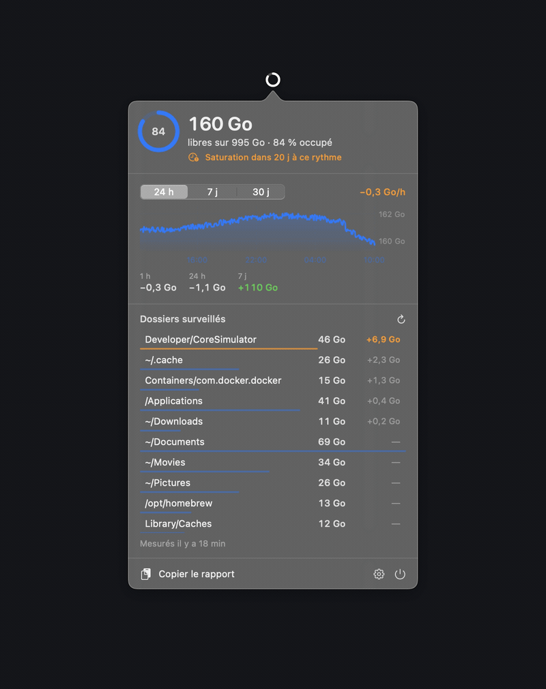
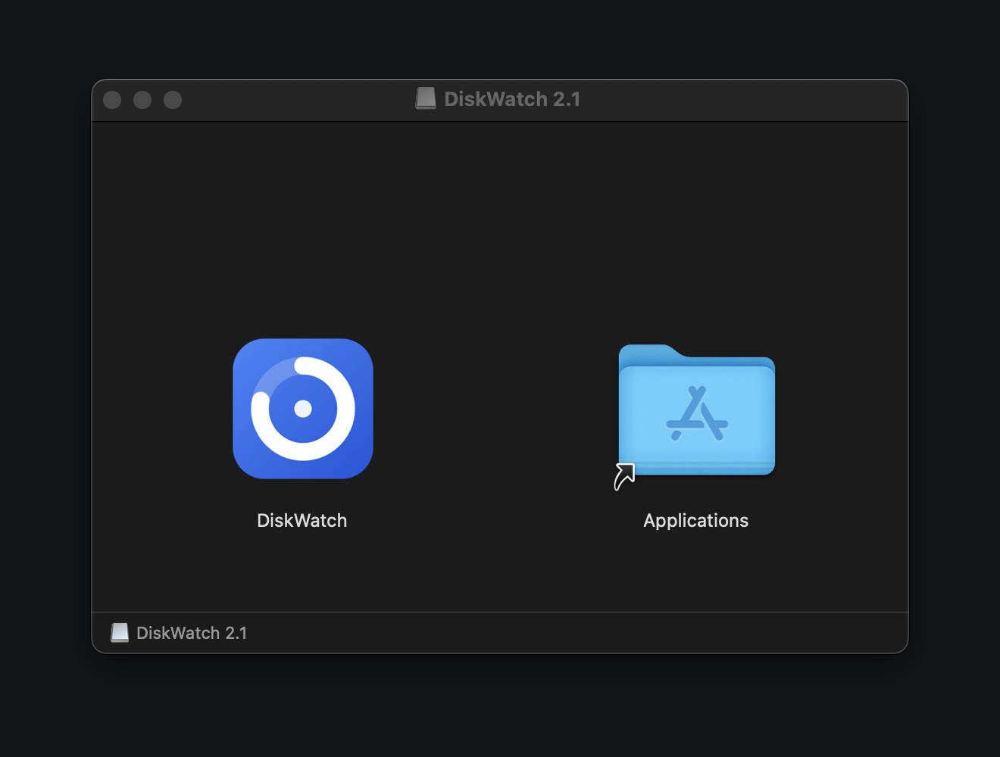
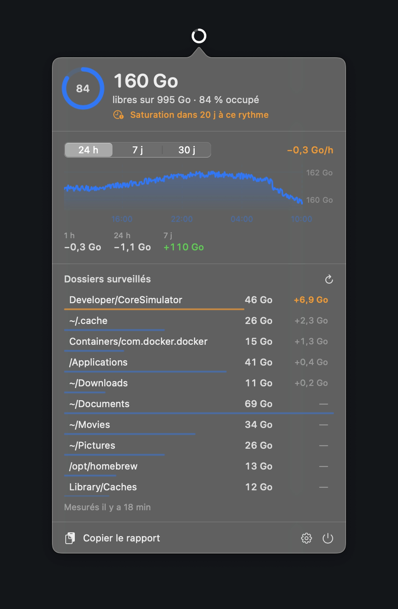
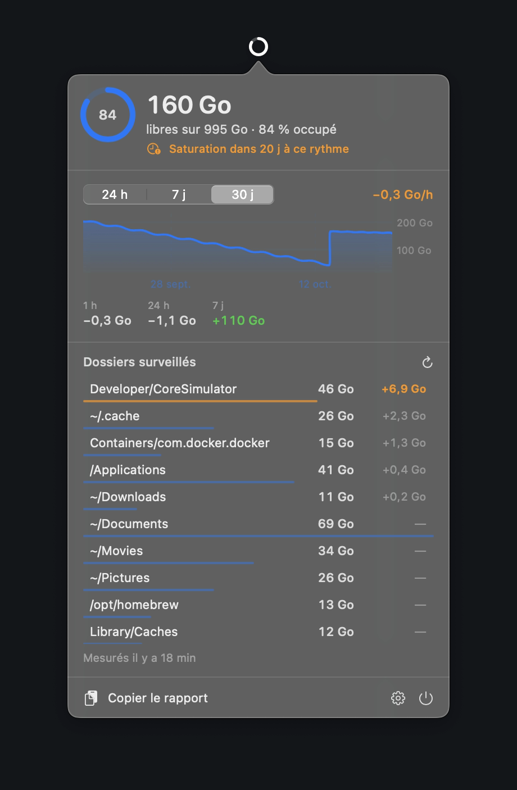
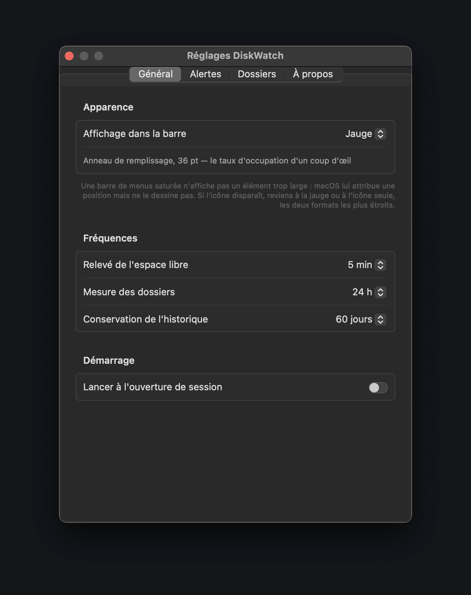
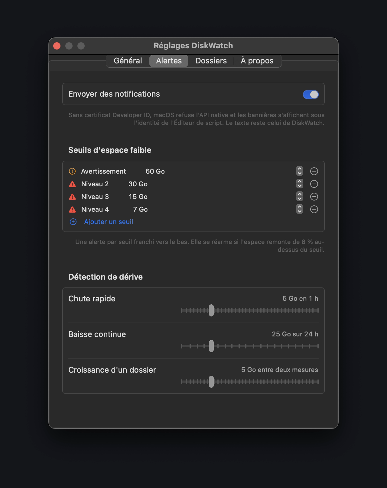
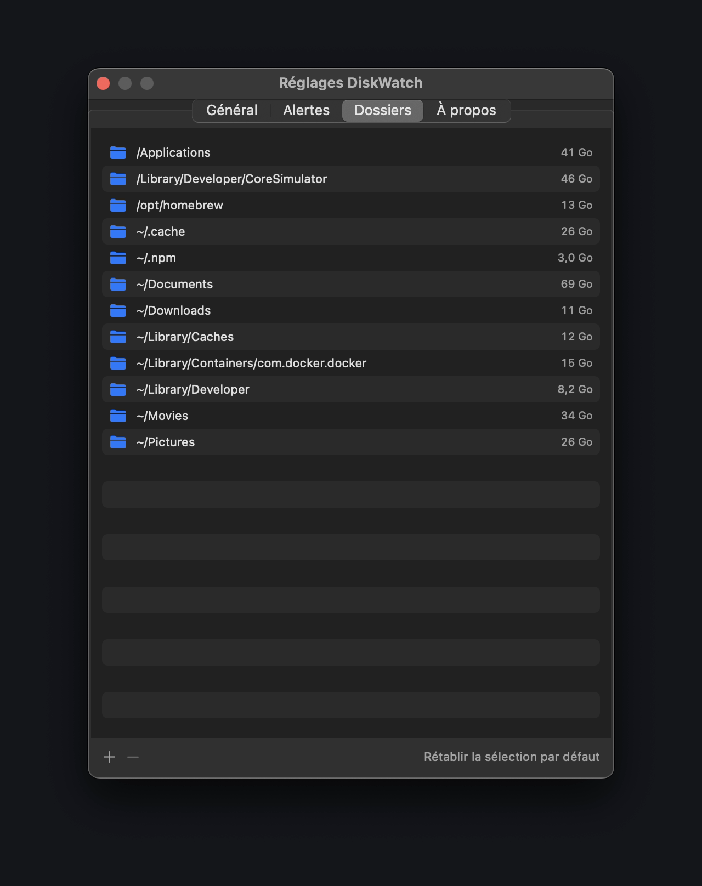
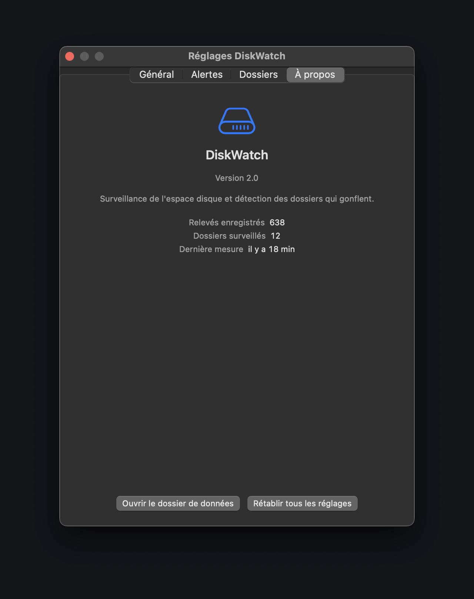
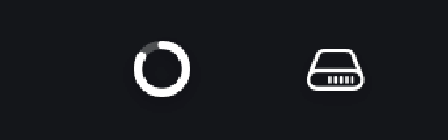

<div align="center">


# DiskWatch

<sub>[Français](README.md) · **English**</sub>

**Disk space monitoring in the macOS menu bar,
with an alert the moment a folder starts swelling.**

[](https://www.apple.com/macos/)
[](https://swift.org)
[](#architecture)
[](LICENSE)



</div>

---

A disk almost never fills up all at once. It fills up through a forgotten build
directory, a cache that never purges, one more Docker image. By the time macOS
warns you, it is too late to find out **who** took the space.

DiskWatch samples free space every five minutes, measures the folders you point
it at, and warns you the moment one of them grows — not three weeks later.

Written in Swift with **no external dependencies**: AppKit, SwiftUI, Swift
Charts and `du`. 1,892 lines, a **903 KB** binary.

> **A note on language.** The interface is in French. The code and this README
> are the only parts available in English for now. If you would use an English
> UI, open an issue — localisation is a small, well-scoped change.

## Installation

### Disk image

Download the `.dmg` from the [latest
release](https://github.com/UnixSafe/DiskWatch/releases/latest), then drag
DiskWatch into Applications.

<div align="center">

</div>

**macOS will block the app on first launch**: it is ad-hoc signed, with no
Developer ID certificate. **Right-click DiskWatch.app ▸ Open**, then **Open** in
the dialog. Once is enough.

If the message says the app is "damaged", that is the quarantine attribute:

```bash
xattr -dr com.apple.quarantine /Applications/DiskWatch.app
```

### From source

```bash
git clone https://github.com/UnixSafe/DiskWatch.git
cd DiskWatch
./build.sh                 # installs into ~/Applications
open ~/Applications/DiskWatch.app
```

`./build.sh /Applications` to install elsewhere, `./make-dmg.sh` to build the
disk image. Requires macOS 14 or later and the Xcode command line tools for
`swiftc`.

## The panel

<div align="center">

</div>

Left-click the menu bar icon:

- **capacity ring** and free space, with the usage ratio;
- **projected exhaustion** — "saturation dans 20 j à ce rythme", *full in 20
  days at this rate* — shown only when the slope is clearly negative, and never
  beyond a year;
- **chart** over 24 hours, 7 days or 30 days, plus a GB/h trend smoothed over
  3 hours;
- **deltas** at 1 hour, 24 hours and 7 days;
- **watched folders**, fastest-growing first then largest, each with its size,
  its delta and a proportion rule;
- **report copied** as plain text to the clipboard.

Right-click: context menu with settings, report, scan now, quit.

The 30-day view shows what 24 hours cannot — here a slow drift, then a big
cleanup:

<div align="center">

</div>

## The four alerts

| Alert | Trigger | Repeat guard |
|---|---|---|
| Low space | crossing a threshold, 60 / 30 / 15 / 7 GB by default | once per threshold, rearmed if space climbs 8 % above it |
| Rapid drop | losing ≥ 5 GB in 1 hour | 30 min, and triggers a folder scan |
| Steady decline | losing ≥ 25 GB over 24 hours | 24 h |
| Swelling folder | a folder gains ≥ 5 GB between two scans | 6 h per folder |

A rapid drop chains into a folder scan: you first get "−7 GB in 1 hour", then
"Developer/CoreSimulator: +6.8 GB" a few minutes later. The culprit names
itself.

## Settings

Four tabs, applied live — no restart needed.

| | |
|---|---|
|  |  |
| **Général** — menu bar format, sampling and scan intervals, history retention, launch at login. | **Alertes** — notifications, low-space thresholds (freely added and removed), sensitivity of the three drift detectors. |
|  |  |
| **Dossiers** — the list of watched paths with their measured size. Added through a Finder picker. | **À propos** — counters, access to the data folder, reset. |

Avoid nesting one watched path inside another: sizes would be counted twice and
the deltas would become meaningless.

## The menu bar icon

<div align="center">

</div>

Four formats: **gauge** (34 pt, left above), **plain icon** (38 pt, right),
**icon + number**, **icon + size**. The gauge gives the usage ratio at a glance
and remains the default — for the reason explained right below.

## Two limits, stated plainly

### The menu bar can be full

When it is saturated, macOS assigns a position to the new item but **does not
draw it**. This is not specific to DiskWatch: the symptom reproduces with a
twelve-line test app.

Measured on the development machine, with a well-filled menu bar:

| Format | Width | Drawn? |
|---|---|---|
| Gauge | 34 pt | yes |
| Plain icon | 38 pt | yes |
| Icon + number | 73 pt | **no** |

In "icon + number", the accessibility API reports a position and a size, but
`CGWindowListCopyWindowInfo` returns no window at all: the slot is reserved,
nothing is painted. Hence the gauge by default. If the icon stays invisible, you
need to free up room in the menu bar.

To tell whether the item is drawn or merely allocated:

```bash
osascript -e 'tell application "System Events" to tell process "DiskWatch" \
  to get {position, size} of menu bar item 1 of menu bar 1'
```

Compare the reported position with that of the leftmost visible item.

### Banners carry the Script Editor's identity

The app is ad-hoc signed. Without a Developer ID certificate, macOS withholds
the `UNUserNotificationCenter` authorisation and the code falls back to
`osascript`. Alerts arrive normally; only the branding is wrong.

With a certificate, replace `codesign --force --sign -` with your identity in
`build.sh`: the code switches to the native API on its own, since the
authorisation is re-read on every send.

## Permissions

Folder measurement reads `~/Documents`, `~/Downloads` and `~/Library`. macOS
asks for permission on the first pass. To stop being interrupted, grant **Full
Disk Access** to DiskWatch.app in System Settings ▸ Privacy & Security. Denied
folders are simply absent from the reading, with no error.

## Data

Everything lives in `~/Library/Application Support/DiskWatch/`, in plain text,
and nothing leaves the machine:

| File | Contents |
|---|---|
| `history.jsonl` | one sample per line, pruned by the retention setting (~1 MB/year) |
| `folders.json` | the last two scans, to compute deltas |
| `state.json` | repeat-guard memory for alerts |
| `config.json` | the settings |

## Cost

Sampling free space is a system call, negligible. Folder measurement runs
`du -skx` under `nice -n 10`, six in parallel, at the chosen interval: a few
minutes of low-priority inode reading, cancellable from the panel.

## Architecture

```
Sources/
  Support/Formatting.swift   French formats, path abbreviation
  Models/Models.swift        samples, snapshots, settings, severity
  Core/Disk.swift            data volume reading
  Core/Store.swift           persistence (append-only JSONL)
  Core/FolderScanner.swift   parallel du, cancellable
  Core/Analyzer.swift        trends and ranking
  Core/Notifier.swift        notifications, with osascript fallback
  Core/LoginItem.swift       SMAppService, with LaunchAgent fallback
  App/AppState.swift         observable state, orchestration, alerts
  App/AppController.swift    status item, panel, settings window
  UI/Theme.swift             colours and metrics
  UI/StatusIcon.swift        menu bar icon rendering
  UI/PanelView.swift         main panel
  UI/SettingsView.swift      settings

Resources/
  make-icon.swift            draws the application icon
  make-icns.sh               assembles the .icns at every size

build.sh                     compiles, builds the bundle, signs
make-dmg.sh                  builds the distribution disk image
```

The screenshots in this README use a demo dataset: the paths shown are generic
system folders, not those of a real machine.

## Licence

MIT — see [LICENSE](LICENSE).
Changelog: [CHANGELOG.md](CHANGELOG.md).
